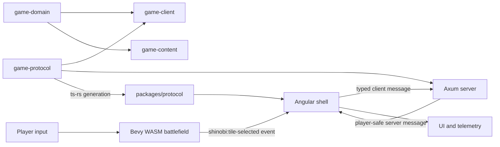

# Shinobi Showdown

Developer workspace for **Shinobi Tactics**, a private two-player isometric
tactics game. The repository combines a deterministic Rust rules foundation,
an Axum WebSocket server, a Bevy WebAssembly battlefield, and an Angular
application shell in one Nx workspace.

> [!IMPORTANT]
> The repository is currently at the **M0 stack-and-contracts spike**. It proves
> that the browser shell, WASM renderer, generated protocol, and local server
> work together. It is not yet a playable match implementation.

## Table of contents

- [Current status](#current-status)
- [Architecture](#architecture)
- [Repository layout](#repository-layout)
- [Prerequisites](#prerequisites)
- [First-time setup](#first-time-setup)
- [Run the project](#run-the-project)
- [Common commands](#common-commands)
- [Development workflows](#development-workflows)
- [Testing and CI](#testing-and-ci)
- [Configuration](#configuration)
- [Troubleshooting](#troubleshooting)
- [Requirements and contribution rules](#requirements-and-contribution-rules)
- [Rights and assets](#rights-and-assets)

## Current status

The M0 spike currently provides:

- an Angular shell that owns browser networking and application UI;
- a Bevy WASM client that renders an 8×8 procedural isometric grid;
- logical tile picking, selection highlighting, and browser custom events;
- an Axum health endpoint and development-only typed WebSocket echo endpoint;
- Rust protocol DTOs with generated TypeScript bindings;
- a validated example map with six unique spawn cells;
- Rust, Angular, protocol, and two-browser integration tests; and
- GitHub Actions validation for formatting, linting, tests, builds,
  typechecking, generated code, and the browser smoke test.

The following are intentionally not implemented yet:

- rooms, matchmaking, team selection, or a complete match lifecycle;
- authoritative turns, combat, visibility, chakra, jutsu, or victory rules;
- production authentication, persistence, deployment, or observability; and
- licensed Naruto artwork, audio, names, or other franchise assets.

The repository name is **Shinobi Showdown**. The current in-product title is
**Shinobi Tactics**.

## Architecture

Angular owns the only browser WebSocket. Bevy is a renderer and input surface:
it emits player intentions to Angular and does not receive unrestricted server
state.



The main boundaries are deliberate:

- `game-domain` contains pure, deterministic values and rules. It must not
  depend on rendering, filesystems, clocks, or networking.
- `game-content` owns versioned content schemas and validation.
- `game-protocol` contains only player-safe wire and interoperability DTOs.
  Raw authoritative match state must not cross this boundary.
- `game-server` is the server host. Its current echo socket is development
  scaffolding, not a production match endpoint.
- `game-client` owns Bevy rendering and input translation, not networking.
- `apps/web` owns the browser connection, application state, and surrounding
  UI.

### Technology stack

| Area                    | Technology                           |
| ----------------------- | ------------------------------------ |
| Workspace orchestration | Nx 23 and npm workspaces             |
| Web application         | Angular 22, TypeScript 6, SCSS       |
| Renderer/input          | Bevy 0.20 compiled to WebAssembly    |
| Server                  | Rust, Axum 0.8, Tokio                |
| Shared contracts        | Serde, `ts-rs`, generated TypeScript |
| Unit tests              | Cargo test and Angular/Vitest        |
| End-to-end tests        | Playwright with Chromium             |

Resolved versions are recorded in `package-lock.json`, `Cargo.lock`, and
`rust-toolchain.toml`; direct dependency constraints live in the corresponding
package manifests.

## Repository layout

```text
.
├── apps/
│   ├── web/                 Angular application shell
│   └── web-e2e/             Playwright two-browser smoke test
├── assets/                  Cleared or original future media only
├── content/
│   └── maps/                Versioned map/content fixtures
├── crates/
│   ├── game-client/         Bevy renderer and WASM entry point
│   ├── game-content/        Content schemas and validation
│   ├── game-domain/         Pure deterministic domain types/rules
│   ├── game-protocol/       Rust wire DTOs and TS generator
│   └── game-server/         Axum HTTP/WebSocket server
├── docs/requirements/       Product, system, UX, and handoff specifications
├── packages/protocol/       Generated TypeScript protocol package
├── tests/integration/       Home for cross-runtime integration fixtures
├── tools/scripts/           Workspace build scripts
├── Cargo.toml               Rust workspace
├── nx.json                  Nx workspace configuration
└── package.json             npm scripts and JS workspace configuration
```

The eight Nx projects are `web`, `web-e2e`, `protocol`, `game-client`,
`game-content`, `game-domain`, `game-protocol`, and `game-server`.

## Prerequisites

- Node.js `>=24.15.0 <27`
- npm 12
- Rust 1.97.1 through [rustup](https://rustup.rs/)
- `wasm-bindgen-cli` 0.2.129
- Chromium installed through Playwright for end-to-end tests

The checked-in Rust toolchain file pins Rust, `rustfmt`, `clippy`, and the
`wasm32-unknown-unknown` target. Using rustup allows Cargo to select it
automatically inside this repository.

## First-time setup

From the repository root:

```sh
rustup toolchain install 1.97.1 \
  --profile minimal \
  --component rustfmt,clippy \
  --target wasm32-unknown-unknown

npm ci

cargo install wasm-bindgen-cli \
  --version 0.2.129 \
  --locked

npm exec playwright install chromium
```

On Linux, if Playwright reports missing operating-system libraries, use:

```sh
npm exec playwright install --with-deps chromium
```

Confirm the workspace is visible to Nx:

```sh
npm exec nx show projects
```

## Run the project

Start the Angular application and Rust server together:

```sh
npm run dev
```

The first run also generates the TypeScript protocol and builds the Bevy WASM
bundle.

| Service               | Address                           |
| --------------------- | --------------------------------- |
| Angular application   | <http://localhost:4200>           |
| Server health check   | <http://127.0.0.1:3000/health>    |
| Development WebSocket | `ws://localhost:3000/ws/dev/echo` |

The health endpoint should return a response similar to:

```json
{
  "status": "ok",
  "protocol_version": "0.1.0"
}
```

In the browser:

1. Select **Connect** and confirm the local server state becomes `connected`.
2. Select **Ping** and confirm the last server event becomes `pong`.
3. Select **Load battlefield** to initialize the Bevy WASM canvas.
4. Select a tile to see its logical coordinate and send the typed intention
   through Angular when the socket is connected.

Press `Ctrl+C` in the development terminal to stop both processes.

## Common commands

Run commands from the repository root. Prefer these npm/Nx entry points so
dependencies and generated artifacts run in the correct order.

| Command                                         | Purpose                                             |
| ----------------------------------------------- | --------------------------------------------------- |
| `npm run dev`                                   | Start the server and Angular development app        |
| `npm run build`                                 | Build every Nx project with a build target          |
| `npm run build:wasm`                            | Produce the Bevy bundle in `dist/wasm`              |
| `npm run protocol:generate`                     | Regenerate TypeScript DTOs from Rust                |
| `npm run test`                                  | Run workspace unit tests                            |
| `npm run lint`                                  | Run ESLint and Rust Clippy targets                  |
| `npm run typecheck`                             | Run TypeScript typechecking targets                 |
| `npm run format`                                | Format TypeScript, Markdown, JSON, and Rust files   |
| `npm run format:check`                          | Verify formatting without changing files            |
| `npm run verify`                                | Run formatting, lint, tests, builds, and typechecks |
| `npm exec nx run web-e2e:e2e`                   | Run the two-browser runtime smoke test              |
| `npm exec nx run game-protocol:check-generated` | Verify committed bindings are current               |

Run a single project target while iterating:

```sh
npm exec nx run game-domain:test
npm exec nx run game-server:lint
npm exec nx run web:test
npm exec nx run web:build
```

Inspect available projects or the fully resolved targets for a project:

```sh
npm exec nx show projects
npm exec nx show project web
```

## Development workflows

### Change the shared protocol

Rust is the protocol source of truth.

1. Update the player-safe DTOs in `crates/game-protocol/src/lib.rs`.
2. Update Rust protocol tests.
3. Regenerate the TypeScript projection:

   ```sh
   npm run protocol:generate
   ```

4. Update Angular consumers and tests.
5. Verify that generated files are committed and reproducible:

   ```sh
   npm exec nx run game-protocol:check-generated
   ```

Do not edit `packages/protocol/src/generated/bindings.ts` by hand. The generator
rewrites and formats it.

### Change the Bevy client

The native Rust target provides fast compiler feedback and unit tests. The WASM
target validates browser integration.

```sh
npm exec nx run game-client:check
npm exec nx run game-client:test
npm run build:wasm
```

`tools/scripts/build-wasm.sh` performs a locked release build and runs
`wasm-bindgen`. Its output is generated under `dist/wasm` and copied into the
Angular build under `/wasm`.

### Change game rules or content

- Put pure coordinate, grid, and future match rules in `game-domain`.
- Put serializable definitions and content validation in `game-content`.
- Keep renderer types, transport types, filesystem access, and wall-clock time
  out of `game-domain`.
- Add deterministic tests alongside each rule.
- Treat `content/maps/m0-isometric-spike.json` as a development fixture, not as
  hard-coded game logic.

### Change the server

Run the server independently with:

```sh
npm exec nx run game-server:serve
```

The default Cargo feature enables `/ws/dev/echo`. This route is temporary
development scaffolding and should not become part of the production match
protocol.

Production networking must preserve the protocol's player-safe boundary and
must not serialize unrestricted authoritative state to clients.

## Testing and CI

The test layers have different responsibilities:

- **Rust unit tests** cover coordinates, projection round-trips, content
  validation, DTO serialization, and server origin checks.
- **Angular/Vitest tests** cover the application shell and generated protocol
  package.
- **Playwright** opens two isolated browser contexts, connects both to the local
  server, and initializes the Bevy WASM battlefield.

The E2E target starts or reuses both development servers, so `npm run dev` is
not required first:

```sh
npm exec nx run web-e2e:e2e
```

Before opening a pull request, run:

```sh
npm run verify
npm exec nx run game-protocol:check-generated
npm exec nx run web-e2e:e2e
```

GitHub Actions performs the same categories of validation on pushes to `main`
and on pull requests. See `.github/workflows/ci.yml` for the canonical CI
sequence.

## Configuration

| Variable              | Default                 | Use                      |
| --------------------- | ----------------------- | ------------------------ |
| `SHINOBI_SERVER_ADDR` | `127.0.0.1:3000`        | Axum bind address        |
| `RUST_LOG`            | `info`                  | Rust tracing filter      |
| `BASE_URL`            | `http://localhost:4200` | Playwright page base URL |

The Angular development transport currently expects the server on port `3000`
and derives its hostname from the loaded page. The development echo endpoint
accepts only `http://localhost:4200` and `http://127.0.0.1:4200` origins. Changing
ports or serving the UI from another host therefore requires a corresponding
development transport/origin change.

## Troubleshooting

### `wasm32-unknown-unknown` is not installed

```sh
rustup target add wasm32-unknown-unknown --toolchain 1.97.1
```

### `wasm-bindgen: command not found`

Install the version matched to the Rust dependency:

```sh
cargo install wasm-bindgen-cli --version 0.2.129 --locked
```

### Playwright cannot find Chromium

```sh
npm exec playwright install chromium
```

Use `--with-deps` on Linux when system browser libraries are also missing.

### Port 3000 or 4200 is already in use

Stop the existing process before running `npm run dev`. The current browser
transport and server origin allowlist assume these development ports.

### Generated protocol validation fails

Regenerate the bindings, review the diff, and commit the Rust and TypeScript
changes together:

```sh
npm run protocol:generate
git diff -- packages/protocol/src/generated
```

### Nx reports stale workspace state

```sh
npm exec nx reset
```

Then rerun the original Nx target. Do not delete source files or lockfiles to
work around an Nx cache problem.

### The battlefield does not load

1. Check the browser console for a WASM loading error.
2. Confirm `wasm-bindgen-cli` is installed at version 0.2.129.
3. Rebuild with `npm run build:wasm`.
4. Confirm generated files exist under `dist/wasm`.
5. Restart `npm run dev`.

## Requirements and contribution rules

The versioned specifications are the source of truth for planned product
behavior:

- [Development handoff](docs/requirements/README_Handoff.md)
- [System requirements](docs/requirements/System_Requirements_v0.5.md)
- [UI/UX requirements](docs/requirements/UI_UX_Requirements_v0.5.md)

When working from those documents:

- preserve the distinction between **CONFIRMED**, **PROPOSED**, and **OPEN**;
- do not silently turn a proposed default or open decision into a requirement;
- let the system requirements govern authoritative rules and permissible data
  disclosure;
- let the UI/UX requirements govern interaction and presentation;
- keep generated protocol bindings synchronized with their Rust source; and
- add tests at the narrowest deterministic layer, followed by integration or
  browser coverage where a boundary is involved.

The implementation-approval instructions in `AGENTS.md` apply to repository
changes: propose intended logic, assumptions, edge cases, and tradeoffs before
modifying project files.

## Rights and assets

Only original or explicitly cleared artwork, audio, fonts, and other media may
be added to `assets/`. The current grid is procedural and contains no Naruto
franchise assets.

This technical prototype does not grant rights to Naruto characters, names,
branding, artwork, or audio. Rights must be resolved before any public
distribution that uses protected franchise material.
