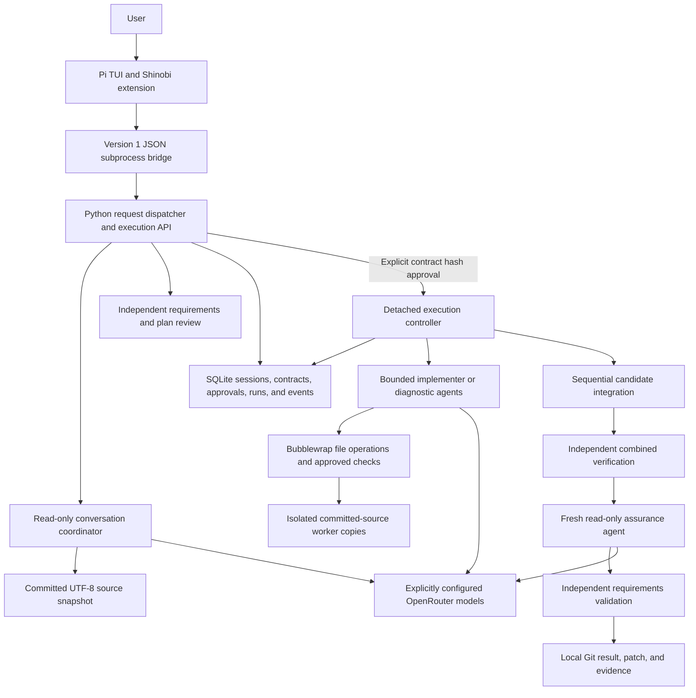

# Shinobi Agent implementation

Implementation snapshot: **2026-10-11**, including the local engineering-skills
and opt-in autonomy increment on the `05cedb1` baseline, followed by the requirements-grounded lifecycle implementation and the Shinobi-owned
skill library. Earlier evidence below
retains the source identities it actually tested.

Shinobi Agent is a local repository engineering runtime. Pi provides the
conversation and controls; a Python Deep Agents/LangGraph backend owns proposals,
approval, isolated execution, verification, independent review, and local
deliverables. The supported execution profile is offline Linux with system tools.

Use this guide to understand what exists and where to inspect it. Use the
[runtime README](README.md) for setup and executable contract examples, the
[development roadmap](../../docs/agent-development/DEVELOPMENT_SLICES.md) for
remaining work, and the dated evidence reports for validation results. Source and
saved evidence determine implementation status; a roadmap requirement alone does
not establish working behavior.

## Contents

- [Implemented scope](#implemented-scope)
- [Architecture and source map](#architecture-and-source-map)
- [Conversation and approval](#conversation-and-approval)
- [Execution, verification, and delivery](#execution-verification-and-delivery)
- [Specialist workflows and scheduling](#specialist-workflows-and-scheduling)
- [Source and sandbox boundaries](#source-and-sandbox-boundaries)
- [Controls, durable state, and recovery](#controls-durable-state-and-recovery)
- [Configuration and limits](#configuration-and-limits)
- [Validation and recorded evidence](#validation-and-recorded-evidence)
- [Limitations and maintenance](#limitations-and-maintenance)

## Requirements-grounded lifecycle

See [LIFECYCLE.md](LIFECYCLE.md) for the current skill inventory, requirement
lineage, planning review, test admission and correction workflows. Executable
contracts now require lifecycle records and independent planning review. The
execution graph includes grounding and final requirements validation; diagnosis
and slice reviews occur before implementation/integration. Historical evidence
below retains the versions it tested.

Core additions are `engineering.py` (strict stage records), `lifecycle.py`
(traceability and planning/review gates) and `lifecycle_execution.py` (diagnosis,
independent stage assessment and test admission). Failed planning reviews persist
in `planning_reviews`; run stage reviews, admissions and validation persist in
run state and delivered evidence. The controller binds these modules and all
selected skill resources. Existing approvals lacking the new canonical fields
require replacement review.

Current validation is recorded in [LIFECYCLE_EVIDENCE.md](LIFECYCLE_EVIDENCE.md):
84 Python tests, 11 bridge tests, both scripted Pi integration checks and 42/42
scripted evaluation trials passed. The subsequent
[live evaluation](LIFECYCLE_LIVE_EVIDENCE.md) completed 0/7 corpus cases before
execution; the separate live Pi integration check passed. The report identifies
coordinator validation-feedback and structured-output gaps; the live failures
remain recorded and no runtime fixes were applied during that evaluation.

## Implemented scope

The identifiers below follow the consolidated roadmap. Older evidence used
coarser local slice numbers.

| Slice                       | Current implementation                                                                                                                           | Qualification                                                                                                                                 |
| --------------------------- | ------------------------------------------------------------------------------------------------------------------------------------------------ | --------------------------------------------------------------------------------------------------------------------------------------------- |
| S0 — Pi → Deep Agent POC    | Separate historical POC in [tools/pi-deepagent-poc](../pi-deepagent-poc/README.md).                                                              | Historical live validation is recorded in its [evidence](../pi-deepagent-poc/EVIDENCE.md).                                                    |
| S1 — Understand and propose | Committed-source discovery, continuing conversations, validated citations, task classification, and versioned proposals.                         | Supported local profile; broad repository quality has not been established.                                                                   |
| S2 — Approve a task         | Full effective contract display, exact hash approval, schema-2 authority, and source/model/environment/workflow/check-input binding.             | Chat and guidance cannot grant execution authority; legacy approvals require replacement review.                                              |
| S3 — Implement one task     | Detached controller, isolated worker copies, scope enforcement, stop controls, reconciliation, and explicit recovery.                            | Offline Linux/system-tools profile; dependency installation and additional profiles remain open.                                              |
| S4 — Verify and repair      | Protected checks, unchanged-baseline observations, combined verification, fresh independent review, bounded repairs, and local artifacts.        | Model assurance complements checks; it does not prove every natural-language requirement.                                                     |
| S5 — Specialist workflows   | Four playbooks, repository-owned guidance, per-role model selection, declared dependencies/interfaces, selective repair, and evaluation tooling. | Repeated live comparisons, broader evaluation, optional integrations, and selective steering remain unfinished.                               |
| S6 — GitHub/VPC factory     | Planned in the roadmap.                                                                                                                          | Issue intake/approval, distributed execution, VPC workers, PR publication, revision-bound CI/staging, and remote cleanup are not implemented. |

Successful delivery produces an isolated local result. Verification, user
acceptance, application to the user's checkout, publication, deployment, and merge
are separate facts. The runtime implements the local verification/delivery path.

## Architecture and source map



The controller and model clients run outside repository sandboxes. Repository
code and file operations run inside them, without provider credentials or backend
state. Pi transports input and displays backend results; Python owns approval and
run state. Closing the UI does not own the lifetime of an approved controller.

| Source                                                                                                                  | Responsibility                                                                                                                                                                            |
| ----------------------------------------------------------------------------------------------------------------------- | ----------------------------------------------------------------------------------------------------------------------------------------------------------------------------------------- |
| [launch.ts](launch.ts)                                                                                                  | Launch Pi with the Shinobi extension, an isolated temporary Pi profile, and native tools/skills/context loading disabled.                                                                 |
| [extension.ts](extension.ts)                                                                                            | Route text input and `/shinobi-*` commands, render contracts/findings, select sessions, and poll durable progress.                                                                        |
| [bridge.ts](bridge.ts)                                                                                                  | Typed version-1 request/response transport, one Python child per request, bounded output, timeout, and transport cancellation.                                                            |
| [runner.py](runner.py)                                                                                                  | Validate and dispatch requests, run read-only conversation turns, validate outcomes/citations, and persist only completed conversational context.                                         |
| [contracts.py](contracts.py)                                                                                            | Strict transport, citation, proposal, and conversational outcome schemas.                                                                                                                 |
| [agent.py](agent.py)                                                                                                    | Configure explicit OpenRouter models and restricted Deep Agents for coordinator, implementer, and reviewer roles; collect tool evidence and redact known credential patterns from output. |
| [repository.py](repository.py)                                                                                          | Export read-only conversation snapshots from Git blobs, validate safe paths, deny repository writes, and verify cited lines were read.                                                    |
| [store.py](store.py)                                                                                                    | SQLite conversation records, proposal versions, completed checkpoint selection, and session locks.                                                                                        |
| [execution_contracts.py](execution_contracts.py)                                                                        | Effective execution settings, contract schema, scope/DAG validation, limits, worker/diagnostic reports, and acceptance coverage.                                                          |
| [execution_api.py](execution_api.py)                                                                                    | Compile effective contracts, enforce explicit approval, launch detached controllers, reconcile status, and record steering before new chat.                                               |
| [execution_store.py](execution_store.py)                                                                                | Immutable contract records, approvals, request idempotency, run ownership, controls, events, and transactional budget guards.                                                             |
| [execution.py](execution.py)                                                                                            | Controller graph, bounded specialist invocation, scheduling, integration, verification/review/repair gates, delivery, and recovery reconciliation.                                        |
| [workspace.py](workspace.py)                                                                                            | Independent Git repositories, raw committed-byte export, content manifests, scope validation, conflict detection, integration, and binary-capable patches.                                |
| [sandbox.py](sandbox.py) and [sandbox_fileop.py](sandbox_fileop.py)                                                     | Bubblewrap/prlimit execution and trusted, ownership-checked file operations.                                                                                                              |
| [profiles.py](profiles.py)                                                                                              | Measure system tools, backend/controller identity, dependency metadata, and execution policy; reject environment drift.                                                                   |
| [verification.py](verification.py)                                                                                      | Freeze selected check inputs, capture baseline/candidate evidence, validate artifact identity, and reject missing/skipped/reduced unittest evidence.                                      |
| [workflows.py](workflows.py)                                                                                            | Versioned playbooks/guidance, compatible role/model selection, scheduling conflicts, and dependent repair invalidation.                                                                   |
| [evaluation.py](evaluation.py), [evaluation harness](tests/evaluate_local.py), and [corpus](tests/workflow_corpus.json) | Versioned fixture trials, independent judges, configuration comparisons, and human-review eligibility without automatic adoption.                                                         |

## Conversation and approval

1. Start a session against an explicit Git repository and selected committed
   revision, defaulting to `HEAD`. Shinobi records the resolved commit and exports
   a read-only conversational snapshot. Dirty, staged, and untracked source is
   excluded.
2. Ordinary input goes to the Python coordinator. It can inspect source, answer,
   ask material questions, or return a proposal. It cannot implement or execute
   repository checks. Citation validation requires an available file, a valid
   line range, and an actual read covering those lines; it does not validate the
   semantic truth of the claim.
3. A completed proposal records task type, objective, constraints, exclusions,
   approach, affected paths, acceptance criteria, questions, and draft checks/work
   items. Fixes/features name changed behavior; refactors name preserved behavior.
   Only a validated completed turn advances the saved conversation checkpoint.
   Failed/interrupted turns remain visible and are not automatically replayed.
4. `/shinobi-contract [settings JSON]` compiles the current proposal into an
   effective contract. Explicit settings can supply checks, work items, limits,
   diagnostic mode, role models, and guidance. Effective check/assignment IDs are
   reconciled in the contract without rewriting the historical proposal turn.
5. Pi displays the full effective JSON and its hash. The user reviews that
   contract and invokes `/shinobi-approve <displayed-contract-hash>`. Approval
   creates a durable queued run and requests a detached controller launch.

The canonical contract uses **schema 2**, policy **`local-bwrap-v2`**, and measured
environment profile **`offline-linux-system-v2`**. Its SHA-256 hash binds all fields:
proposal/contract versions, source commit, mode, behavior, paths, checks, work
items, limits, role models, workflow/guidance, environment, and protected inputs.

Compilation rejects unresolved proposal questions, unspecified task types,
invalid scope, duplicate IDs, unknown/cyclic dependencies, uncovered affected
paths, and producer/consumer inputs without declared dependency edges. Writable
scope consists of explicit repository-relative files or directory prefixes ending
in `/`; globs, traversal, Git metadata, backend state, and dependency trees are
rejected. New test files need approved ownership.

Approval must select the latest contract and current proposal version. The
source repository's current `HEAD` must match the contract commit, even if the
conversation originally selected another revision. The configured coordinator
model must match, and environment/workflow fingerprints must still agree.
Dispatch/recovery rechecks those bindings; delivery rechecks environment and
workflow identity. Changes requiring new authority stop for replacement review.

Execution requests bind their request ID to the complete input hash. Reusing an
ID with different input is rejected. A unique contract-to-run binding prevents
repeated approval delivery from creating another run. Historical raw contracts
remain inspectable; schema-1/unknown-policy approvals cannot execute or silently
acquire schema-2 authority through defaults.

## Execution, verification, and delivery

An approved controller follows these gates:

1. **Prepare and characterize.** Acquire the run lock, revalidate authority,
   export committed bytes into an independent Git baseline, and preflight the
   sandbox. Run approved checks on the unchanged baseline and persist their
   artifact/environment/protected-input identities. `baseline_requirement:
"observe"` can record a bug reproduction failure; `"pass"` must succeed before
   work starts. Refactors require at least one passing characterization check.
2. **Implement or diagnose.** Schedule dependency-ready work items. Each attempt
   receives its own source copy, recorded baseline, input manifest, approved
   ownership, and bounded role context. Implementers can read, write/replace/delete
   owned UTF-8 files, and invoke approved check IDs. Diagnostic agents receive
   read/check tools only. Worker checks are advisory.
3. **Integrate.** Validate the attempt's scope and baseline, reject conflicting
   changes, and integrate completed work sequentially into a new candidate copy.
   Validate overall scope and protected inputs, commit raw bytes/modes, and
   transactionally select the immutable candidate pointer and completion record.
4. **Verify the combined artifact.** The controller runs every approved check on
   the integrated result, independently of worker claims. Records include phase,
   argv, cwd, exit expectations/results, output, duration, artifact hash,
   environment, and protected-input identity. Missing dependencies/environment
   and missing evidence stop the run rather than spend code-repair cycles.
5. **Review independently.** A fresh read-only reviewer receives the effective
   contract, complete diff, current integrated worker reports, baseline/candidate
   checks, and controller identities. A passing review must cover each acceptance
   criterion exactly once with approved check IDs and concrete explanations, with
   no unresolved findings. Parsed review candidates remain recorded even if
   coverage validation rejects them. A recommendation cannot waive a failed check.
6. **Repair within authority.** Failed combined checks or a changes-required
   review can reschedule affected work within the approved repair allowance.
   A scope/decision amendment stops for new approval. Every repair repeats the
   full combined checks and fresh review before delivery.
7. **Deliver.** Require current passing checks/review for the exact content and
   revalidate protected inputs/environment/workflow. Write the patch and standalone
   evidence, then transactionally mark the run `verified`.

Existing committed test/runner/config inputs discovered by
`verification.oracle_file` are protected by default, including executable modes.
Explicit `checks[].protected_paths` can select committed independent fixtures
instead. A repository-based check requires protected input; Python `-c` checks
bind their inline oracle directly through approved argv. Selecting different
oracle inputs requires a new contract. Workers cannot weaken a protected input,
even when it lies within their writable scope. New tests can be added within
approved paths. This protects selected inputs, not the adequacy of every assertion.

For stdlib `unittest` commands, an empty suite, skipped tests, absent test-count
evidence, or a reduced passing candidate test count cannot establish verified
completion. All implementation checks must expect exit code zero. Diagnostic
reproductions may explicitly expect a nonzero exit.

The local artifact record identifies:

- The run-owned Git workspace and its `shinobi-result` branch.
- Original source revision, synthetic local result revision, and content hash.
- `runs/<run-id>/result.patch`, including binary-capable changes, and patch hash.
- `runs/<run-id>/evidence.json`, containing the contract, baseline/final checks,
  reviews, attempts, allowances consumed, and observed execution token usage.
- Disposition: `changed`, `already_satisfied`, or `diagnostic`.

The result repository has synthetic local history; its commit is not a branch
created in the user's source repository. Source hooks/filters cannot substitute
different bytes for the artifact that checks observed. The runtime never
automatically applies the patch to the user's checkout.

An unchanged implementation needs passing baseline checks and an explicit
independent `already_satisfied` finding. A diagnostic uses an empty patch and
requires substantive nonempty observations and limitations, displayed in condensed
form by Pi and retained in full in evidence. A fix following diagnosis needs a
separate implementation proposal and approval.

## Specialist workflows and scheduling

Playbooks are versioned repository-owned guidance for model behavior. Controller
gates enforce execution authority separately.

| Task type       | Intended process                                                                     | Enforced distinctions                                                                                                                                                                  |
| --------------- | ------------------------------------------------------------------------------------ | -------------------------------------------------------------------------------------------------------------------------------------------------------------------------------------- |
| `investigation` | Clarify, inspect, compare explanations, synthesize.                                  | Executable investigation uses `mode: "diagnostic"`, empty affected/owned paths, declared inputs, and read-only agents; a grounded conversational answer can also end an investigation. |
| `bug_fix`       | Reproduce, explain cause, implement, repeat reproduction, check regressions, assure. | Name changed behavior; baseline observations and protected final checks remain recorded.                                                                                               |
| `feature`       | Clarify behavior/interfaces, implement, integrate, verify, assure.                   | Name changed behavior, resolve proposal questions, and cover affected paths with ownership.                                                                                            |
| `refactor`      | Characterize, preserve baseline, restructure, compare, assure.                       | Name preserved behavior and require a passing unchanged-baseline characterization check.                                                                                               |

The three built-in MIT guidance entries are `bounded-implementation`,
`independent-assurance`, and `source-investigation`. Selection validates known
provenance/version, policy, role, and capabilities. Guidance cannot add tools or
authority. External skills and Pi packages are not imported automatically.

The `skills/` directory now contains a Shinobi-owned library registered in
`skills/catalog.json`: 20 primary procedures, six maintenance procedures,
14 specialists, one opt-in autonomy procedure and three compatibility guides.
See [SKILLS.md](SKILLS.md) for the actual local names, routing and procedural
choices. Selected mechanisms were adapted from the reviewed collections; there
is no dependency on upstream repositories, packages or update scripts.

The coordinator reads a fixed local catalogue and proposes applicable skills with
a rationale. Compatible execution roles receive selected instructions, and
`read_engineering_skill` exposes selected local resources. Source ancestry and MIT
notices are retained separately from the maintained procedure. Contract hashes
bind current local bytes; changing those bytes requires fresh approval for an
existing task, not an upstream hash match. Requirements discovery and maintenance
are optional; execution defaults are task-sensitive rather than every skill at
once. Availability does not establish model compliance or missing capabilities.

The original three skills require an explicit `engineering` plan. Its acceptance entries bind
each criterion to check IDs, an observable surface, expected results and stated
limitations. Quality requirements reference executable checks. The controller
rejects incomplete mappings and reviewer coverage that substitutes other checks.
Optional per-check numeric measurements parse a single JSON object from stdout
and enforce finite approved thresholds; results record observed values against
the baseline and candidate identities. Missing/ambiguous evidence blocks delivery.
This establishes the declared checks and thresholds, not their semantic adequacy.

`autonomy: "within_contract"` is an explicit user selection in the reviewed
contract. The coordinator can offer it but cannot activate it. The Pi command
`/shinobi-autonomy on|off` only drafts a new contract; `/shinobi-approve <hash>`
still authorizes the first execution. Opt-in guidance permits routine decisions
within approved behavior and scope without repeated consent. Standard execution
already runs approved work and bounded repairs autonomously. The option changes
guidance, not sandbox capabilities, budgets, verification gates, or amendment
requirements. It cannot be toggled during an active run or inherited by a new task.
Old contracts lacking the new canonical fields require replacement review.

`role_models` can select `implementer` and `reviewer` models explicitly;
`coordinator` must match the configured conversation model. Unspecified roles use
that model. Each selection and reviewed guidance fingerprint is contract-bound.
Default execution uses one implementer and a fresh reviewer; a contract can
explicitly select at most two concurrent workers.

Scheduling admits dependency-ready items with disjoint ownership. Overlapping
paths, matching shared `interfaces`, and producer/consumer `input_paths` prevent
concurrent dispatch. A consumer of an upstream owned path must declare the
producer in its transitive `depends_on` graph. Consumed input manifests bind
attempts to what they read; missing or changed input identity prevents resuming
obsolete work. Declarations do not discover every semantic coupling automatically.

Selective repair uses check `affected_items` or reviewer work-item references,
then invalidates transitive dependents, shared interfaces, and input consumers.
Other completed items are retained. Unlocalized failures conservatively
reschedule all approved items. **User steering currently invalidates the whole
run**; selective steering is remaining work.

## Source and sandbox boundaries

Conversation and execution both use committed Git blobs and preserve the user's
working tree, index, and untracked files. Conversation snapshots include ordinary
UTF-8 files up to 1 MiB and exclude binaries, symlinks, and submodules. Execution
snapshots preserve ordinary binary blobs and executable modes but reject symlinks
and submodules. Both have a 100 MiB / 10000-file snapshot limit; model file tools
operate on UTF-8 files up to 1 MiB.

Repository execution uses Bubblewrap mount/network/PID/IPC/user isolation,
dropped capabilities, and disabled further user namespaces. System tool mounts
and the trusted file helper are read-only. Check commands see a read-only worker
repository and a 64 MiB writable temporary filesystem. Only the trusted file
helper receives a writable worker mount and enforces safe paths and ownership.

The sandbox clears the process environment and does not mount provider
credentials, the user's home or source checkout, backend databases, host
`node_modules`, virtual environments, or dependency caches. Model clients use
provider credentials outside it. There is no network/dependency-installation
fallback, and sandbox failure blocks execution.

Workers have no unrestricted shell tool. Approved checks use exact argument
arrays and a fixed executable allowlist: `python3`, `python3.12`, `node`, `npm`,
`npx`, `git`, `cargo`, and `rustc`. Allowlisted commands still execute inside the
sandbox; accepting argv does not establish that a stack's dependencies exist.
The first supported profile is Linux system tooling, especially Python
stdlib/unittest. Dependencies must already be available through permitted system
tools or the committed snapshot.

Default Deep Agents delegation, shell execution, repository mutation tools,
skills, and todo workflows are disabled. The controller supplies each role's
explicit tools. Internal state reads can inspect ephemeral agent artifacts;
repository file operations still use the controlled source backends/sandbox.

The measured profile captures installed tool hashes/versions, kernel/architecture,
backend versions, trusted controller file hashes, dependency-metadata Git blobs,
mount/network policy, and per-process limits. It is not a hermetic image of every
system library byte. Resource limits are per process, without aggregate cgroup
memory or PID quotas.

## Controls, durable state, and recovery

| Pi command                               | Backend behavior                                                                        |
| ---------------------------------------- | --------------------------------------------------------------------------------------- |
| `/shinobi-new /absolute/repository`      | Create a committed-source conversation at `SHINOBI_REVISION`, default `HEAD`.           |
| `/shinobi-resume <session-id>`           | Restore a backend conversation and reconnect to its selected contract/run.              |
| `/shinobi-session` / `/shinobi-sessions` | Inspect the current session or list the latest 50 sessions.                             |
| `/shinobi-contract [settings JSON]`      | Compile and display a contract without approving it.                                    |
| `/shinobi-autonomy on\|off`              | Draft a per-contract autonomy preference; review and approve the new exact hash.        |
| `/shinobi-approve <hash>`                | Approve the exact latest hash and request detached execution.                           |
| `/shinobi-status`                        | Observe/reconcile durable state, checks, review, and deliverable without new direction. |
| `/shinobi-pause`                         | Stop new work and settle active operations before becoming paused.                      |
| `/shinobi-continue`                      | Explicitly resume a settled paused run under unchanged authority.                       |
| `/shinobi-cancel`                        | Stop work, settle operations, and preserve partial artifacts.                           |
| `/shinobi-steer <instruction>`           | Persist new direction, stop work, and invalidate the current authority.                 |
| `/shinobi-recover`                       | Explicitly request interrupted-controller reconciliation within the allowance.          |

Durable run states include `queued`, `running`, `pausing`, `paused`, `cancelling`,
`interrupted`, and the terminal states `verified`, `failed`, `blocked`,
`cancelled`, and `waiting_approval`. Terminal outcomes need a new contract for
changed work. Failure categories retain the distinction between code, environment,
provider, policy, evidence, compatibility, and budget outcomes.

Ordinary chat during an unfinished run also records steering and invalidates old
authority before invoking the coordinator. Direction survives a later model-call
failure. Revise the proposal, review its replacement contract, and approve it
before further writes. Use status commands to inspect progress.

Pause/cancel first acknowledge an intermediate state while active operations
settle. Sandbox subprocesses are stopped promptly; an active provider call may
take up to its 60-second timeout. No additional tools/dispatch are admitted after
the stop guard observes the control. Cancellation preserves partial work and
does not imply rollback or cleanup.

Closing Pi aborts its adapter transport/current conversation request. An approved
detached controller continues independently; reconnect through the saved backend
session. Native Pi session changes affect adapter selection, not run ownership.

State defaults to ignored `tools/shinobi-agent/.state/`, configurable with
`SHINOBI_STATE_DIR`. Principal entries are:

| State path                             | Contents                                                                                              |
| -------------------------------------- | ----------------------------------------------------------------------------------------------------- |
| `sessions.sqlite`                      | Sessions/turns plus additive contract, approval, run, event, execution-request, and direction tables. |
| `checkpoints.sqlite`                   | Conversation LangGraph checkpoints; the selected completed checkpoint determines continuing context.  |
| `sessions/<session-id>/repository/`    | Read-only conversational source snapshot; the session directory also holds its process lock.          |
| `runs/<run-id>/baseline/`              | Independent unchanged committed-source baseline.                                                      |
| `runs/<run-id>/attempts/<attempt-id>/` | Worker repository, report identity, and specialist `agent.sqlite` checkpoints.                        |
| `runs/<run-id>/integrations/`          | Candidate repositories selected by transactional integration pointers.                                |
| `runs/<run-id>/`                       | Run lock, controller log/checkpoints, result patch, and standalone evidence.                          |

SQLite write transactions and local process locks protect authority, budgets,
ownership, and integration. Within a state directory, only one unfinished run
per source repository is permitted, and at most two specialist slots are active.
These are local coordination mechanisms, not a distributed queue or cross-host
lease protocol. State retains source/conversation data; cleanup is not automated.

Status detects an unfinished run whose controller lock has no owner and records
an interruption rather than invoking a model automatically. Explicit recovery
rechecks source/model/environment/workflow, the integration pointer/content,
baseline evidence and its gates, partial scope safety, and consumed input
identity. Recovering active interrupted attempts consumes the replan allowance.
Fresh agent context inspects partial owned files; old tool calls are not replayed.
Completed attempt reports can be integrated after reconciliation. Changed
baselines, unsafe/tampered partial artifacts, or exhausted allowances stop work.

## Configuration and limits

| Setting              | Meaning                                                                                            |
| -------------------- | -------------------------------------------------------------------------------------------------- |
| `OPENROUTER_API_KEY` | Provider credential supplied through the process environment.                                      |
| `SHINOBI_MODEL`      | Required explicit tool-capable `vendor/model` ID; there is no default.                             |
| `SHINOBI_REPOSITORY` | Initial repository selection; `/shinobi-new` can supply a path.                                    |
| `SHINOBI_REVISION`   | Conversation revision, default `HEAD`; execution approval requires matching current source `HEAD`. |
| `SHINOBI_SESSION_ID` | Initial saved backend session to resume.                                                           |
| `SHINOBI_STATE_DIR`  | Private backend state root.                                                                        |
| `SHINOBI_PYTHON`     | Adapter's Python executable override, default the tool's `.venv/bin/python`.                       |

Models with vendor prefixes `openai`, `anthropic`, or `openrouter` are excluded by
local validation. Configuration disables automatic routing/fallbacks, SDK retries,
and ambient LangSmith tracing. Source content is sent to the configured model for
processing. There is no production scripted-model switch.

| Execution contract limit              | Default | Allowed maximum |
| ------------------------------------- | ------- | --------------- |
| Concurrent workers                    | 1       | 2               |
| Repair cycles                         | 2       | 2               |
| Recovery replans                      | 1       | 1               |
| Wall-clock seconds                    | 900     | 3600            |
| Execution model calls                 | 60      | 200             |
| Graph steps per specialist invocation | 30      | 60              |

Contracts may select validated bounds; defaults do not grant additional scope.
The execution wall clock starts at dispatch and includes paused time. Conversation
calls are separate from the execution model-call allowance. Call/graph limits
are not a dollar spending cap; provider cost remains unknown when unmeasured.

Adapter requests have a 120-second timeout, 64 KiB request/stderr limits, and a
256 KiB response limit. Effective contract JSON is limited to 192 KiB for display.
Checks have approved 1–120-second timeouts and 128 KiB combined sandbox output.
Per-process `prlimit` bounds include 8 GiB address space, 120 CPU seconds, 16 MiB
file size, and 128 file descriptors. The writable sandbox temporary filesystem is
64 MiB. These do not establish aggregate memory/PID quotas for an entire run.

## Validation and recorded evidence

The latest [Shinobi-owned skill revision](SKILLS_EVIDENCE.md) passed structural
validation for all 44 entries, 88 Python tests, 11 bridge tests, both scripted Pi
integration checks, typecheck, lint and formatting. It verifies local skill
maintenance, selection and contract/resource binding. No live provider evaluation
ran for this revision; the earlier live failures below remain unresolved evidence.

The latest lifecycle regression passed 84 Python tests, 11 bridge tests, both
scripted Pi integration checks and 42/42 scripted evaluation trials. The subsequent
live evaluation with `deepseek/deepseek-v4.1-flash` completed **0/7 corpus cases**;
all stopped before contract creation or execution. The separate live Pi integration
check passed through final requirements validation and reconnection. These results
demonstrate a working bounded execution path and a remaining coordinator reliability
gap. See the lifecycle evidence entries below for tested identities and failures.

The earlier 2026-10-11 engineering-skills/autonomy increment passed 73 Python tests,
10 bridge tests, both scripted Pi conversation/execution flows, TypeScript
type checking, lint and formatting checks. The three skill files passed the
skill-creator frontmatter validator. `shinobi-agent:test` exercised the real
controller, graph, Bubblewrap and Pi with scripted model output; no live-provider
quality or cost comparison was performed for this increment. The new acceptance
tests cover plan/checkpoint handoff, skill drift, invalid coverage and numeric
evidence, threshold failures, advisory offers, and exact-hash autonomy approval.
The initial outer-sandbox run was blocked by Bubblewrap's NETLINK_ROUTE restriction;
the successful rerun used the host permissions needed to test Bubblewrap itself.
An adversarial reviewer fixture was corrected to actually omit its mapped check
before the final successful run.

Nx exposes setup, serve, test, typecheck, lint, formatting, live smoke, and
evaluation targets. Setup/commands and an effective settings example are in the
[README](README.md#start). Useful verification entry points are:

```bash
# Offline/scripted runtime regression, including both actual Pi flows.
npm exec -- nx run-many -t test typecheck lint format-check -p shinobi-agent

# Seven current fixture cases, three repetitions, one and two workers, scripted generation.
npm exec -- nx run shinobi-agent:evaluate

# Live provider acceptance; supply SHINOBI_MODEL and OPENROUTER_API_KEY first.
npm exec -- nx run shinobi-agent:smoke-live
npm exec -- nx run shinobi-agent:smoke-execution-live
npm exec -- nx run shinobi-agent:evaluate-live
```

The `test` target runs bridge tests, Python runtime/sandbox tests, and actual Pi
TUI conversation/execution flows. Scripted generation replaces only model output;
contracts, graph execution, sandboxing, integration, verification, review gating,
and fixture judges still run. Pi smoke tests include a fail-on-call native provider
and a negative control to establish the backend inference path.

| Evidence                                                                                                  | Recorded result                                                                                                             | What it establishes                                                                                      |
| --------------------------------------------------------------------------------------------------------- | --------------------------------------------------------------------------------------------------------------------------- | -------------------------------------------------------------------------------------------------------- |
| [Lifecycle regression](LIFECYCLE_EVIDENCE.md)                                                             | 84 Python tests, 11 bridge tests, both scripted Pi flows and 42/42 scripted trials passed.                                  | Controller behavior on seven fixtures with scripted proposals and reviews.                               |
| [Lifecycle live evaluation](LIFECYCLE_LIVE_EVIDENCE.md) and [captured JSON](LIFECYCLE_LIVE_EVIDENCE.json) | 0/7 corpus cases completed; separate live Pi integration passed.                                                            | Invalid plans and structured outputs stop before execution; coordinator reliability remains unresolved.  |
| [EVIDENCE.md](EVIDENCE.md)                                                                                | Earlier local acceptance/regression and live Pi results.                                                                    | Historical implementation baseline; its older test counts/slice numbering are retained.                  |
| [LOCAL_S5_EVIDENCE.md](LOCAL_S5_EVIDENCE.md)                                                              | 2026-10-10 regression: 60 Python tests, eight bridge tests, both scripted Pi flows, typecheck, lint, and formatting passed. | Recorded supported-profile regression, not tests rerun to write this guide.                              |
| [Captured JSON](LOCAL_S5_EVIDENCE.json)                                                                   | Repeated scripted evaluation passed 36/36 trials across six cases, three repeats, and one/two workers.                      | Controller/fixture behavior with no observed false success or unauthorized source/scope change.          |
| [Live evidence](LOCAL_S5_EVIDENCE.md#live-validation-and-retained-failures)                               | Full live run reached 5/6, followed by successful targeted diagnostic and detached Pi runs after fixes.                     | Historical live fixture acceptance; not a complete repeated live evaluation of the final implementation. |

Saved failures, amendments, invalid structured output, and provider HTTP 504s
remain visible. Later targeted successes do not erase earlier failures or establish
a reliability rate. Referenced raw `/tmp` artifacts can be temporary; the captured
JSON preserves selected evidence and tested content/configuration hashes.

The evaluation corpus covers investigation, fix, feature, refactor, independent
work, and coupled work, with development and held-out cases. Reports bind corpus,
runtime/harness, and configuration hashes; retain correct/false completions,
scope/source violations, failed outcomes, calls, repairs, latency variability,
and available usage; and keep unmeasured cost/human effort unknown.

Changing worker/model defaults requires human review of live baseline/candidate
results with at least three repetitions per case/configuration, complete held-out
coverage, no false successes or unauthorized actions, quality at least the
sequential baseline, and at least 10% measured latency or known-cost improvement.
The harness reports eligibility and never adopts a configuration automatically.
Scripted results cannot satisfy this gate. The small stdlib corpus does not
establish broad repository quality or statistical confidence.

## Limitations and maintenance

The immediate known gap is coordinator correction before contract approval.
Current provenance validation happens after coordinator invocation, lifecycle
mapping validation happens during contract compilation, and structured-output
errors terminate the turn. The live failures include non-verbatim quotes,
misassigned exclusions, uncovered invariants, token-limit truncation and duplicate
`Outcome` calls. Rejection prevents invalid work from progressing but does not
guide the coordinator to a corrected proposal.

The [proposed follow-up](LIFECYCLE_LIVE_EVIDENCE.md#root-cause-findings-and-recommended-next-slice)
is **not implemented**: read-only draft validation with actionable errors, at most
two corrections within existing graph/deadline limits, explicit provenance/mapping
rules, and distinct handling of truncated or duplicate output. Independent planning
review, exact first-contract approval, budgets and execution scope remain mandatory.
The failed live cases must be rerun after an approved correction slice; prior
scripted success cannot substitute for that evidence.

Remaining local work includes repeated final live quality/cost comparisons,
representative repository evaluation, additional approved stack profiles,
dependency bootstrap, aggregate resource quotas, selective steering, and optional
external skills/Pi packages. The documented profile measures an installed
environment, not a hermetic image. State/artifact retention and cleanup remain
manual.

S6 remains planned: authenticated issue triggers and approvals, shared queue and
recovery, VPC worker hosting, GitHub publication, revision-bound CI/staging, human
disposition, and operational cleanup. The repository's existing
[GitHub workflow](../../.github/workflows/ci.yml) provides ordinary CI; it is not
connected to an implemented agent factory. Infrastructure, identity, storage,
staging, retention, and spending decisions remain in the roadmap.

When runtime behavior changes, update this guide and its inspected snapshot,
the README's operator instructions, and the roadmap's corresponding status/remaining
work. Preserve dated evidence as historical records and add new validation evidence
with its tested identities. Do not turn scripted checks, targeted live acceptance,
or planned capabilities into claims of general production readiness.
